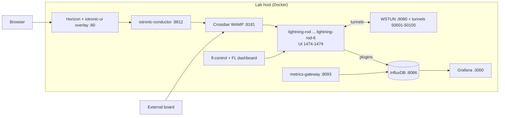

# Assembling Smart CPS: Hands-on Training Lab

Modular training material and lab overlay for **Assembling Smart Cyber-Physical Systems** (Elsevier), aligned with the [AssemblingSmartCPS](https://github.com/AssemblingSmartCPS) GitHub organization. It lets a class deploy a [Stack4Things](https://github.com/MDSLab) (IoTronic + Lightning-Rod) lab on one Docker host, run guided modules A-I (deployment, plugins, environmental data to InfluxDB, multi-board fleets, virtual networking, WoT/WSTUN web services, federated learning, Blueprint/K3s, FaaS) and validate each step with scripts.

**420 slides** across 10 English PPTX decks (generated by `generate_slides_modular_en.py`; count verified on regeneration). Slide and handout URLs use the placeholder `{{VM_IP}}`: replace it with your lab host address before presenting.

Lab networking and external boards: [`docs/LAB_NETWORK_ACCESS.md`](docs/LAB_NETWORK_ACCESS.md). Change history: [`docs/CHANGELOG.md`](docs/CHANGELOG.md). Italian setup guide: [`GUIDA_SETUP.md`](GUIDA_SETUP.md).

---

## Architecture



What this repo adds on top of the upstream book repositories (cloned into `repos/`, git-ignored):

| Part | Location | Purpose |
|------|----------|---------|
| Compose overlay | `patches/docker-compose.lab.yml` | extra Lightning-Rod boards, InfluxDB, Grafana, metrics gateway, FL control, log proxy, patched Horizon UI |
| Horizon panels | `patches/iotronic_ui_*_lab/`, `patches/iotronic_ui_lab/`, `patches/horizon-enabled/` | lab versions of Boards/Fleets/Plugins panels plus Federated Learning, Metrics, WoT panels |
| Demos | `experiments/` | federated learning, metrics, multi-board, virtual networking, web services |
| Fixed upstream examples | `ch14-fixed/`, `ch15-lab/` | HelloName plugin (class `Worker`) and Ch.15 plugin with `host=influxdb` (see `docs/BOOK_DIFFERENCES.md`) |
| Operations | `lab-ops/`, `scripts/` | manual Lightning-Rod create/destroy, onboarding, proxies, screenshots |
| Validators | `validate/`, `validate-lab*.sh` | per-module checks and `validate/validate-all.sh` |
| Slides | `decks/`, `generate_slides*.py`, `slides/` | slide sources, generators, generated decks |

## Requirements

| Need | Version / note |
|------|----------------|
| OS | Linux lab host (Debian/Ubuntu tested by the original authors); macOS/Windows only as browser clients |
| Docker Engine + Compose v2 | `docker compose` (no fixed version; 8+ GB RAM, 20+ GB disk recommended for the full stack) |
| Git, curl, Bash 4+ | for scripts |
| Python 3.10+ | only for regenerating slides and for host-side helper scripts (tested here with 3.10.13) |
| `python-pptx>=0.6.21`, `Pillow>=10.0.0` | `requirements.txt` (slide generation; tested with python-pptx 1.0.2, Pillow 12.1.1) |
| Network | Docker Hub and GitHub access to build/pull the lab images |

## For students (reproducibility)

1. **Clone this repo** and set your lab host IP:
   ```bash
   git clone https://github.com/lucadagati/assembling-cps-training.git
   cd assembling-cps-training
   cp vm-ip.txt.example vm-ip.txt    # edit: ONE line with the address used to reach the lab host
   export S4T_LAB_HOST=$(cat vm-ip.txt)
   ```

2. **Clone book repos** and start Stack4Things:
   ```bash
   chmod +x scripts/clone-repos.sh && ./scripts/clone-repos.sh
   cd repos/ch13
   docker compose -f docker-compose.yml -f ../../patches/docker-compose.lab.yml up -d
   ```

3. **Validate** the environment:
   ```bash
   cd ../..
   ./validate/validate-all.sh
   ```

   Expected output of the validators: one `PASS`/`FAIL` line per module and a final `All module validators passed`. Without a running lab they fail (they test live HTTP endpoints); that is expected.

4. **Follow the lab** using:
   - [`HANDS_ON_COMMANDS.md`](HANDS_ON_COMMANDS.md) — copy-paste commands (EN)
   - [`GUIDA_SETUP.md`](GUIDA_SETUP.md) — setup guide (IT)
   - [`PORT_FORWARDING.md`](PORT_FORWARDING.md) — browser URLs
   - [`docs/LAB_NETWORK_ACCESS.md`](docs/LAB_NETWORK_ACCESS.md) — ports and external boards
   - [`docs/BOOK_DIFFERENCES.md`](docs/BOOK_DIFFERENCES.md) — book vs lab
   - [`lab-ops/`](lab-ops/) — manual Lightning-Rod create/destroy helpers
   - `slides/Module*.pptx` — decks (Find/Replace `{{VM_IP}}` if needed)

### Core path deliverables (3 h)

| Module | Deliverable |
|--------|-------------|
| A | Screenshot: board **Active** in Horizon + `curl` HTTP 200 on `:8812` |
| B | HelloName Plugin Call output + optional Docker alpine JSON |
| C | InfluxDB rows in `environmental_data` measurement |

### Demo URLs

Use the same host as Horizon plus the published WSTUN port:

```text
http://{{VM_IP}}:50006/   # wot-fritzing (example)
http://{{VM_IP}}/horizon  # Horizon
```

---

## For instructors (teaching)

| Resource | Purpose |
|----------|---------|
| [`slides/*.pptx`](slides/) | Ready-to-project decks with UML sequence diagrams |
| [`docs/MODULES.md`](docs/MODULES.md) | Module A–I map and prerequisites |
| [`docs/DEMO_VERIFICATION.md`](docs/DEMO_VERIFICATION.md) | Verified demo matrix |
| [`docs/CHANGELOG.md`](docs/CHANGELOG.md) | Lab overlay history |
| [`docs/LAB_NETWORK_ACCESS.md`](docs/LAB_NETWORK_ACCESS.md) | Lab host ports / external boards |
| [`decks/*.py`](decks/) | Slide source — edit and regenerate |
| [`assets/`](assets/) | Horizon/LR screenshots + architecture PNGs |
| [`lab-ops/`](lab-ops/) | Manual LR board create / port map |

### Regenerate slides after editing `decks/*.py`

```bash
python3 -m venv .venv
.venv/bin/pip install -r requirements.txt
.venv/bin/python scripts/generate_diagrams.py
.venv/bin/python generate_slides_modular_en.py
```

Optional full lab pipeline (deploy + validate): `./scripts/build-all.sh`

---

## Slide decks (`slides/`)

| File | Module | Topic |
|------|--------|-------|
| `00_Course_Map_EN.pptx` | Overview | Paths 3h / 6h / 9h |
| `ModuleA_Deploy_IOcloud_EN.pptx` | A | Ch.4 + Ch.13 deploy |
| `ModuleB_Plugin_Services_EN.pptx` | B | Ch.14 plugins |
| `ModuleC_IoT_Computation_EN.pptx` | C | Ch.15 environmental |
| `ModuleD_MultiBoard_EN.pptx` | D | Multi-board + fleet |
| `ModuleE_VirtualNetworking_EN.pptx` | E | Ch.5 VN (optional) |
| `ModuleF_WebServices_WoT_EN.pptx` | F | Ch.6 + Ch.14 WoT/WSTUN |
| `ModuleG_FederatedLearning_EN.pptx` | G | Ch.19 FL |
| `ModuleH_Blueprint_K3s_EN.pptx` | H | Ch.11 Blueprint |
| `ModuleI_FaaS_Deviceless_EN.pptx` | I | Ch.7 Deviceless |

See [slides/README.md](slides/README.md) for sequence diagram mapping.

---

## Configuration

| Item | Description |
|------|-------------|
| `INFLUX_PASSWORD` | InfluxDB password used by `experiments/metrics/metrics_server.py` (default `admin`) |
| `S4T_HORIZON_PASS`, `S4T_LR_PASS` | override Horizon / Lightning-Rod passwords in helper scripts |
| `METRICS_SERVER`, `GRAFANA_URL`, `HORIZON_URL` | endpoints used by `experiments/metrics/verify-metrics-lab.py` |
| `ROOT_PASS` | root password of manual Lightning-Rod containers (`lab-ops/01-run-manual-lr.sh`) |
| `vm-ip.txt` | Lab host IP for scripts (gitignored — use `vm-ip.txt.example`) |
| `S4T_LAB_HOST` | Override IP for scripts |
| `{{VM_IP}}` | Placeholder in slides and docs |
| Horizon | `admin` / `s4t` |
| Lightning-Rod | `me` / `arancino` |
| LR container SSH (`lab-ops`) | `root` / `arancino` (inside container only; no host port) |

---

## Verification status

| Item | Status |
|------|--------|
| `py_compile` on all Python files, `bash -n` on all shell scripts, JSON/YAML parse | verified |
| `scripts/generate_diagrams.py` + `generate_slides_modular_en.py` in a temporary copy | verified (16 diagrams, 10 decks, 420 slides) |
| Docker Compose lab, Horizon/Lightning-Rod, InfluxDB/Grafana, federated learning, WSTUN, K3s | not verified in this environment (no Stack4Things lab here); the original authors' results are in `docs/DEMO_VERIFICATION.md` (last run 2026-08-30) |

## Repository layout

```text
assembling-cps-training/
|-- README.md, GUIDA_SETUP.md (IT), HANDS_ON_COMMANDS.md, INSTRUCTOR_PLAYBOOK.md, PORT_FORWARDING.md
|-- decks/                  slide sources (one file per module/slot)
|-- generate_slides*.py     deck generators; slides_apply.py post-processing
|-- slides/                 generated PPTX decks
|-- assets/                 screenshots (chapter13/14/15/19) and diagrams
|-- patches/                compose overlay, Horizon panels, Grafana provisioning, Apache confs
|-- experiments/            federated-learning, metrics, multiboard, virtual-networking, webservices
|-- lab-ops/                manual Lightning-Rod helpers
|-- scripts/                clone-repos, build-all, onboarding, proxies, screenshot capture
|-- validate/, validate-lab*.sh   per-module validators
|-- ch14-fixed/, ch15-lab/  corrected upstream examples
|-- docs/                   modules, network access, book differences, roadmap, changelog
```

## Troubleshooting

| Symptom | Fix |
|---------|-----|
| Validators fail with connection refused | the stack is not up: `docker compose ... ps`, wait for Conductor (`curl http://$S4T_LAB_HOST:8812/`) |
| `repos/ch13 missing` | run `./scripts/clone-repos.sh` first |
| Horizon unreachable from another PC | use `{{VM_IP}}`, not `127.0.0.1`; check firewall for ports 80, 8181, 8080, 50001-50100 |
| Board never goes Active | external boards must reach Crossbar `:8181` and WSTUN `:8080` (see `docs/LAB_NETWORK_ACCESS.md`) |
| HelloName plugin fails | use `ch14-fixed/plugins/synchronous/hello_name_plugin.py` |
| `validate-all.sh` Module I fails | needs the metrics stack (`metrics-gateway` on :8093, Grafana :3000) |

## Security and limitations

- Credentials in this repo (`admin/s4t`, `me/arancino`, InfluxDB `admin/admin`) are the **public defaults of a disposable training lab**. Never expose the stack to the Internet; change them (env variables above) for anything shared.
- Docker publishes ports on `0.0.0.0`; restrict access with a firewall or VPN.
- Lightning-Rod containers use `docker.sock` for the Docker-lifecycle plugin demo: this gives them control of the host Docker, so use a dedicated lab VM.
- Slides regenerated with `generate_slides_modular_en.py` differ byte-wise on every run (timestamps), so regenerate only when `decks/*.py` change.
- Module H (K3s) is theory plus YAML review on the lab VM.

## Extending

- New module: add `decks/<name>.py`, register it in `generate_slides_modular_en.py`, add a `validate-lab-<name>.sh` and call it from `validate/validate-all.sh`.
- New board: add a `lightning-rod-N` service with a unique published port to `patches/docker-compose.lab.yml`.
- New Horizon panel: add a panel under `patches/iotronic_ui_lab/iotronic_ui_lab/iot/` and an enabled file in `patches/horizon-enabled/`.

## Book reference

[Assembling Smart CPS — Elsevier](https://shop.elsevier.com/books/assembling-smart-cyber-physical-systems/benomar/978-0-443-29837-0)

Companion repos: [github.com/AssemblingSmartCPS](https://github.com/AssemblingSmartCPS)

Future extensions: [docs/ROADMAP.md](docs/ROADMAP.md)

## License

Training material follows book companion repo licenses. ch13–ch19 repos are forks of MDSLab projects under their respective terms.
